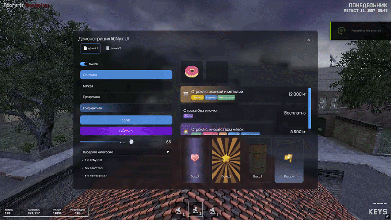
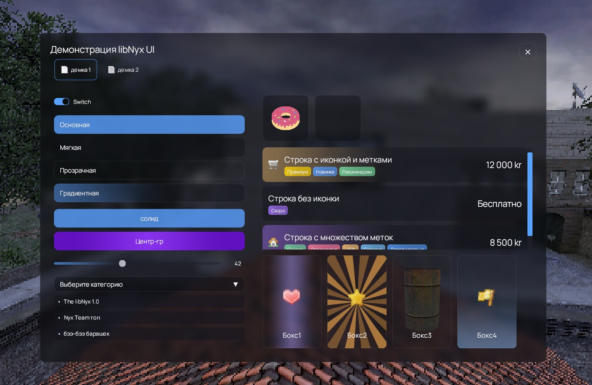
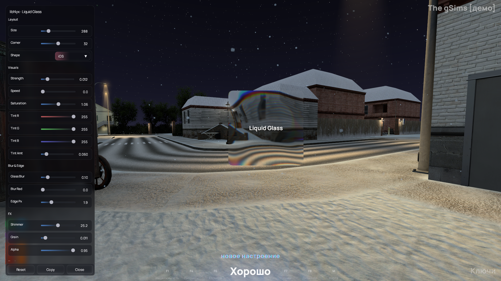

# libNyx — Modern UI & Liquid Glass for Garry's Mod

**libNyx 1.0.0** is a client-side UI toolkit for Garry's Mod, featuring custom Derma components, smooth scrolling, notifications, and shader-powered **Liquid Glass** through the bundled RNDX renderer.



<p align="center">
  
  &nbsp;&nbsp;
  
</p>

**Author:** MaryBlackfild · **Community:** [Discord](https://discord.gg/rUEEz4mfXw) · **License:** [MIT](LICENSE)

## Preview: Liquid Glass


Liquid Glass renders a rounded, translucent surface that samples the scene behind it and applies refraction, tint, optional blur, edge smoothing, shimmer, and grain. It can also respond to the cursor with a smooth, localized distortion.

The built-in **Liquid Glass builder** lets you drag a preview around the screen, adjust parameters live, and copy an RNDX method chain for your own menus or HUDs.

## Contents

- [Installation](#installation)
- [Demo commands](#demo-commands)
- [Liquid Glass: first example](#liquid-glass-first-example)
- [Liquid Glass builder](#liquid-glass-builder)
- [Liquid Glass API reference](#liquid-glass-api-reference)
- [Interactive glass: cursor pull](#interactive-glass-cursor-pull)
- [Shapes, blur, and shadows](#shapes-blur-and-shadows)
- [UI components](#ui-components)
- [Drawing helpers](#drawing-helpers)
- [Notifications and global skins](#notifications-and-global-skins)
- [Scaling, fonts, and sounds](#scaling-fonts-and-sounds)
- [Troubleshooting](#troubleshooting)

## Installation

The downloadable repository contains an **`_libnyx/` addon directory**. Copy that directory into your Garry's Mod `addons` folder. Do **not** place the whole `libnyx-main/` repository wrapper directly into `addons/` and expect the nested Lua files to autoload.

Expected directory structure:

```text
garrysmod/
└── addons/
    └── _libnyx/
        ├── lua/
        │   ├── autorun/
        │   │   └── libnyx.lua
        │   └── libnyx/
        │       ├── VERSION
        │       └── lib/
        │           ├── rndx.lua
        │           ├── libnyx_components.lua
        │           ├── libnyx_maindemo.lua
        │           └── libnyx_liquidglass.lua
        ├── resource/
        │   └── fonts/
        └── sound/
            └── nyx_uniqueui/
```

1. Copy **`_libnyx/`** to `garrysmod/addons/_libnyx/` on the server, or to your local game for client-side testing.
2. Start/restart Garry's Mod or the server and connect with a client.
3. Open the client console to try the demo commands below.

The autorun script sends the necessary Lua files with `AddCSLuaFile` on the server and includes the renderer, UI components, showcase, and Liquid Glass builder on the client. It exposes:

```lua
libNyx.version       -- "1.0.0"
libNyx.rndx          -- RNDX renderer; use this, not a global RNDX variable
libNyx.ui            -- UI toolkit; lowercase "ui"
```

> **Important:** GLua is case-sensitive. `libNyx.ui.createFrame` and `libNyx.rndx()` are correct. `libNyx.UI.CreateFrame` and `RNDX()` are **not** the public names supplied by this package.

**Version note:** The bundled `VERSION` files and loader report `1.0.0`. This version of the loader does **not** implement a remote GitHub update checker, a `libNyx.Ready` flag, or a `cl_libnyx_ui_scale` ConVar.

## Demo commands

Run these in the **client console**:

```text
libnyx_liquid
libnyx_ui_showcase
```

You can also call the UI showcase from clientside Lua:

```lua
libNyx.ui.openShowcase()
```

The Liquid Glass builder is registered as the console command `libnyx_liquid` (it does not have a corresponding `libNyx.ui.openLiquidBuilder()` export).

## Liquid Glass: first example

This is a **complete clientside example** using a standard `DPanel`. Place it in a clientside Lua file that runs **after** the libNyx autorun script. It creates a window with a glass card inside.

```lua
if not CLIENT then return end
if not libNyx or not libNyx.ui or not libNyx.rndx then return end

local ui = libNyx.ui
local rndx = libNyx.rndx

local frame = ui.createFrame({
    w = 720,
    h = 460,
    title = "My Liquid Glass menu",
    blur = false
})

local glass = vgui.Create("DPanel", frame)
glass:SetPos(ui.scale(36), ui.scale(100))
glass:SetSize(ui.scale(320), ui.scale(220))

glass.Paint = function(self, w, h)
    -- Capture the screen-effect texture once per rendered frame.
    rndx.EnsureFB()

    -- Paint uses coordinates local to this panel.
    rndx().Liquid(0, 0, w, h)
        :Rad(ui.scale(28))
        :Color(255, 255, 255, 255)
        :Tint(255, 255, 255)
        :TintStrength(0.06)
        :Saturation(1.06)
        :GlassBlur(0.10, 0.0)
        :EdgeSmooth(2.0)
        :Strength(0.012)
        :Speed(0.0)
        :Shimmer(25.2)
        :Grain(0.01)
        :Alpha(0.95)
        :Flags(rndx.SHAPE_IOS)
        :Draw()

    draw.SimpleText(
        "Hello, Liquid Glass!",
        ui.font(ui.scale(20)),
        w / 2, h / 2,
        ui.style.textColor,
        TEXT_ALIGN_CENTER, TEXT_ALIGN_CENTER
    )
end
```

**How this works:**

1. `rndx.EnsureFB()` refreshes the screen-effect texture used by the glass renderer (at most once per frame through its internal frame check).
2. `rndx().Liquid(x, y, width, height)` starts a glass draw at those coordinates.
3. Methods such as `:Tint(...)` or `:Strength(...)` set properties of **this draw call**.
4. `:Draw()` actually renders the result; **do not omit it**.
5. Draw text and icons **after** the glass so they remain readable on top.

Use the code inside a **client-side 2D painting context** such as `PANEL:Paint` or a suitable HUD rendering hook, not directly in server-side Lua.

## Liquid Glass builder

Open it with:

```text
libnyx_liquid
```

The left panel contains the controls. Drag the glass preview to move it; the preview is restricted to the available screen area. Use **Reset** to restore defaults, **Copy** to copy the current method chain, **Close** or **Esc** to exit.

### What the builder controls

| Group | Control | Default | Builder range | Purpose |
| --- | --- | ---: | ---: | --- |
| Layout | Size | `300` | `220–520` | Preview width and height in pixels (square). |
| Layout | Corner | `32` | `0–64` | Corner radius for iOS/Figma shapes. |
| Layout | Shape | `iOS` | iOS / Figma / Circle | Rounded-shape profile. |
| Visuals | Strength | `0.012` | `0–0.06` | Refraction/displacement strength. |
| Visuals | Speed | `0` | `0–4` | Speed of animated shader effects; zero freezes their time input. |
| Visuals | Saturation | `1.06` | `0.5–1.6` | Saturation of the sampled background. |
| Visuals | Tint R/G/B | `255/255/255` | `0–255` each | RGB tint color. |
| Visuals | Tint Amt | `0.06` | `0–0.35` | How strongly the tint affects the glass. |
| Blur & Edge | Glass Blur | `0.10` | `0–0.5` | Liquid shader blur amount. |
| Blur & Edge | Blur Rad | `0` | `0–4` | Liquid shader blur radius. |
| Blur & Edge | Edge Px | `2.0` | `0–6` | Edge smoothing in pixels. |
| FX | Shimmer | `25.2` | `0–50` | Shimmer/highlight intensity. |
| FX | Grain | `0.01` | `0–0.08` | Fine grain amount. |
| FX | Alpha | `0.95` | `0.2–1` | Liquid effect opacity. |
| Interaction | Enable Cursor Pull | Off | On / Off | Turns on cursor-driven distortion. |
| Interaction | Pull | `0.018` | `0–0.05` | Cursor distortion strength. |
| Interaction | Radius | `120` | `40–240` | Cursor influence area. |
| Interaction | Depth | `0.22` | `0–1` | Glass depth/thickness input. |
| Interaction | Falloff | `1.8` | `0.5–4` | Softness of the cursor influence. |
| Interaction | Smoothing | `24` | `4–48` | Cursor transition/follow smoothing. |
| Shadow | Enable Shadow | On | On / Off | Enables the builder's `:Shadow(...)` setting. |
| Shadow | Spread | `40` | `0–120` | Shadow spread setting. |
| Shadow | Intensity | `56` | `0–180` | Shadow intensity setting. |

The numbers above are the **actual defaults and slider limits from `libnyx_liquidglass.lua`**. These are UI control ranges, not necessarily hard limits of every RNDX method.

### Using the copied code

The current **Copy** button writes the **method chain only**. It starts with `rndx().Liquid(bx,by,bw,bh)`, but does not supply `rndx`, `bx/by/bw/bh`, or the final `:Draw()` call. You must provide those when pasting it into your UI.

For example:

```lua
local rndx = libNyx.rndx

panel.Paint = function(self, w, h)
    local bx, by, bw, bh = 0, 0, w, h
    rndx.EnsureFB()

    rndx().Liquid(bx, by, bw, bh)
        :Rad(32)
        :Color(255, 255, 255, 255)
        :Tint(255, 255, 255)
        :TintStrength(0.06)
        :Saturation(1.06)
        :GlassBlur(0.10, 0.0)
        :EdgeSmooth(2.0)
        :Strength(0.012)
        :Speed(0.0)
        :Shimmer(25.2)
        :Grain(0.01)
        :Alpha(0.95)
        :Flags(rndx.SHAPE_IOS)
        :Draw() -- required; the builder's clipboard text omits this
end
```

Here, `panel` is an existing VGUI panel. The copied settings may differ from these defaults, depending on your selections.

> **Note:** If you enable cursor interaction in the builder, its exported code also uses `gui.MousePos()` and a fixed preview cache key. For a regular VGUI panel, adapt the mouse position to the panel's drawing coordinate system and use a unique key per interactive glass instance (see the example below).

## Liquid Glass API reference

Start a chain with:

```lua
local rndx = libNyx.rndx
rndx().Liquid(x, y, width, height)
    -- settings go here
    :Draw()
```

### Appearance and geometry

| Method | Meaning |
| --- | --- |
| `:Rad(px)` | All four corner radii. |
| `:Radii(tl, tr, bl, br)` | Individual corner radii. |
| `:Flags(rndx.SHAPE_IOS)` | iOS-like squircle profile. |
| `:Flags(rndx.SHAPE_FIGMA)` | Alternative Figma-style rounded profile. |
| `:Flags(rndx.SHAPE_CIRCLE)` | Circular shape profile (use equal width/height and an appropriate radius). |
| `:Color(r, g, b, a)` | Color modulation; separate from `:Tint(...)`. |
| `:Tint(r, g, b)` | RGB tint (three 0–255 numbers, or a GLua `Color`). |
| `:TintStrength(value)` | Strength of the applied tint. |
| `:Saturation(value)` | Saturation multiplier (`1` is neutral). |
| `:Alpha(value)` | Effect alpha; the builder uses values between `0.2` and `1`. |
| `:GlassBlur(amount, radius)` | Blur controls inside the Liquid shader. |
| `:EdgeSmooth(px)` | Softens the rendered glass edge. |
| `:Strength(value)` | Refraction/displacement strength. |
| `:Speed(value)` | Controls the shader's time progression. |
| `:Shimmer(value)` | Controls the highlight/shimmer effect. |
| `:Grain(value)` | Adds fine visual grain. |
| `:Depth(value)` | Glass depth input, clamped to `0–1`. |
| `:Thickness(value)` | Alias for `:Depth(value)`. |
| `:Dispersion(value)` | Dispersion setting, clamped to `0–1`. |
| `:LightAngle(radians)` | Lighting angle in **radians**, not degrees. |
| `:State(state)` | `"idle"`, `"hover"`, `"pressed"`, or `"disabled"` (also accepts numeric states). |
| `:Draw()` | Completes and renders the glass draw. |

### Interaction methods

| Method | Meaning |
| --- | --- |
| `:Cursor(x, y, radius, strength, softness)` | Apply immediate cursor-based distortion. |
| `:CursorUV(u, v, radius, strength, softness)` | Set cursor position using normalized glass coordinates. |
| `:CursorSmooth(key, active, x, y, radius, strength, softness, enterSpeed, exitSpeed, followSpeed)` | Cursor pull with cached position and fade transitions. |
| `:CursorOff()` | Disable cursor influence for this draw. |
| `rndx.ClearLiquidCursorState(key)` | Clear cached smoothing data when an interactive panel is removed. |

`rndx().Liquid(...)` uses **method chaining** and shared renderer internals. Construct a new chain inside each `Paint` call rather than saving the chain object and reusing it between unrelated draws. **Set all appearance properties your effect depends on for each draw:** the constructor resets base geometry/cursor state, but not every Liquid-specific shader property.

## Interactive glass: cursor pull

This example implements the builder's **Enable Cursor Pull** behavior inside an ordinary VGUI panel. It converts mouse coordinates to panel-local space and gives each instance its own smoothing key.

```lua
local rndx = libNyx.rndx
local ui = libNyx.ui

local panel = vgui.Create("DPanel", someParent) -- an existing parent panel
panel:SetSize(ui.scale(320), ui.scale(220))

local cursorKey = "myGlass." .. tostring(panel)

function panel:OnRemove()
    rndx.ClearLiquidCursorState(cursorKey)
end

panel.Paint = function(self, w, h)
    rndx.EnsureFB()

    local mx, my = self:ScreenToLocal(gui.MousePos())
    local inside = mx >= 0 and mx <= w and my >= 0 and my <= h

    rndx().Liquid(0, 0, w, h)
        :Rad(ui.scale(26))
        :Flags(rndx.SHAPE_IOS)
        :Tint(255, 255, 255)
        :TintStrength(0.06)
        :Saturation(1.06)
        :GlassBlur(0.10, 0)
        :EdgeSmooth(2.0)
        :Strength(0.012)
        :Speed(0)
        :Shimmer(25.2)
        :Grain(0.01)
        :Alpha(0.95)
        :Depth(0.22)
        :CursorSmooth(cursorKey, inside, mx, my, 120, 0.018, 1.8, 24, 18, 24)
        :Draw()
end
```

**Understanding the cursor arguments:**

- `key`: a stable identifier for this glass instance, so separate panels do not share animation state.
- `active`: whether the cursor should affect the glass. Passing `false` causes the pull to fade out.
- `x, y`: coordinates in the **same drawing coordinate system** as `Liquid(x, y, ...)`. Convert the screen mouse coordinates with `ScreenToLocal` for `PANEL:Paint`.
- `radius`, `strength`, `softness`: area, pull intensity, and falloff.
- `enterSpeed`, `exitSpeed`, `followSpeed`: response rates for entering, leaving, and following the mouse. These are interpolation speeds, not durations in seconds.

In fullscreen, screen-aligned painting (as used by the builder), `gui.MousePos()` can be passed directly. In nested VGUI panels, always account for the panel's screen position.

## Shapes, blur, and shadows

### Shape selection

```lua
:Flags(rndx.SHAPE_IOS)
:Flags(rndx.SHAPE_FIGMA)
:Flags(rndx.SHAPE_CIRCLE)
```

Pick **one** shape flag for a glass surface. For a circle, use a square draw box and set the radius to half its side:

```lua
local size = 160
rndx().Liquid(0, 0, size, size)
    :Rad(size / 2)
    :Flags(rndx.SHAPE_CIRCLE)
    :Draw()
```

### Two different kinds of blur

- **`:GlassBlur(amount, radius)`** adjusts the blur behavior of the **Liquid shader**.
- **`ui.draw.blur(x, y, w, h, options)`** paints a different rounded, blurred UI background using the underlying RNDX blur path.

They are separate APIs. Do not replace `:GlassBlur(...)` with `:Blur(...)` on a Liquid chain: the Liquid builder does not expose the rectangle builder's `:Blur` method.

### Shadow limitation in this source version

The builder currently exposes a shadow toggle and copies `:Shadow(spread, intensity)` into the chain. However, in the bundled **1.0.0** RNDX source, `Liquid:Draw()` does **not** perform the separate shadow rendering pass that `Rect:Draw()` does. Therefore, **`:Shadow(...)` on Liquid alone should not be relied on to draw a visible drop shadow**.

If you need a shadow, render an explicit shadow pass behind the glass from a suitable parent painting context:

```lua
-- Draw this before the glass, leaving room for the shadow around its edges.
rndx.DrawShadows(
    24,                 -- corner radius
    x, y, w, h,        -- geometry in the current drawing context
    Color(0, 0, 0, 180),
    24, 32,            -- spread, intensity
    rndx.SHAPE_IOS
)
```

VGUI clipping can cut off a shadow that extends outside a child panel's bounds; draw it in a parent panel or reserve extra space.

## UI components

All names below are **case-sensitive**. The current toolkit exports `libNyx.ui.components`, not `libNyx.UI.Components`.

| Component | API |
| --- | --- |
| Window | `ui.createFrame({w = ..., h = ..., title = ..., blur = true})` |
| Button | `ui.components.createButton(parent, text, opts)` |
| Checkbox / switch | `ui.components.createCheckbox(parent, opts)` |
| Slider | `ui.components.createSlider(parent, opts)` |
| Dropdown | `ui.components.createDropdown(parent, opts)` |
| List | `ui.components.createList(parent, opts)` |
| Tabs | `ui.components.createTabs(parent, opts)` |
| Search field | `ui.components.createSearchBox(parent, opts)` |
| Category card | `ui.components.createCategoryCard(parent, opts)` |
| Feature/VBox card | `ui.components.createVBox(parent, opts)` |
| Cell / interactive cell | `ui.components.createCell(...)` / `ui.components.createInteractiveCell(...)` |

Example — a button and a switch:

```lua
local ui = libNyx.ui
local window = ui.createFrame({w = 520, h = 360, title = "Controls"})

local button = ui.components.createButton(window, "Confirm", {
    variant = "primary",
    onClick = function(self)
        notification.AddLegacy("Confirmed!", NOTIFY_HINT, 3)
    end
})
button:SetPos(ui.scale(24), ui.scale(90))
button:SetSize(ui.scale(180), ui.scale(44))

local toggle = ui.components.createCheckbox(window, {
    label = "Enable effects",
    checked = true,
    onChange = function(checked, self)
        print("Effects enabled:", checked)
    end
})
toggle:SetPos(ui.scale(24), ui.scale(155))
```

For working layouts combining these controls, run `libnyx_ui_showcase` or inspect `lua/libnyx/lib/libnyx_maindemo.lua` inside the addon.

## Drawing helpers

### Solid or outlined panel

```lua
ui.draw.panel(0, 0, w, h, {
    radius = ui.scale(16),
    color = ui.style.cardColor,
    stroke = true,
    strokeColor = ui.style.glassStroke
})
```

`ui.draw.panel` accepts `color` (or `fill`), `radius`, `shape`, `stroke`, `strokeColor`, `outline`, `outlineColor`, and `shadow`.

### Blurred panel

```lua
ui.draw.blur(0, 0, w, h, {
    radius = ui.scale(16),
    fill = ui.style.glassFill,
    stroke = true,
    strokeColor = ui.style.glassStroke,
    strength = 1.1
})
```

The options key for blur intensity is **`strength`**, not `blurIntensity`. These are UI drawing helpers, separate from the Liquid shader API.

## Notifications and global skins

The loader automatically installs the global Derma menu skin and schedules installation of the notification skin on the client. You may also call the installers explicitly:

```lua
libNyx.ui.installGlobalMenuSkin()
libNyx.ui.installGlobalNotificationSkin()
```

Once the notification skin is installed, legacy notifications use libNyx's toast UI:

```lua
notification.AddLegacy("Hello from libNyx!", NOTIFY_HINT, 3)
```

Or call the libNyx API directly:

```lua
libNyx.ui.pushNotify("Saved successfully", NOTIFY_GENERIC, 3)
```

The integration also wraps `notification.AddProgress`, `notification.Kill`, and the gamemode's `AddNotify` where available. Toasts appear along the **right side** of the screen, vertically centered as a stack.

## Scaling, fonts, and sounds

### Scaling

`libNyx.ui.scale(value)` uses a resolution-dependent scale based on a **1920×1080** reference and clamps its general scale factor to **0.75–1.75**.

```lua
local ui = libNyx.ui

local padding = ui.scale(24)     -- uniform scale
local width = ui.scaleW(300)     -- width-relative scale
local height = ui.scaleH(160)    -- height-relative scale
local w, h = ui.scalePair(300, 160)
```

Use `ui.style` for shared design tokens such as `radius`, `padding`, `btnHeight`, `rowHeight`, `bgColor`, `panelColor`, `cardColor`, `accentColor`, `textColor`, `glassFill`, and `glassStroke`.

### Fonts

```lua
local fontName = ui.font(ui.scale(20))
draw.SimpleText("libNyx", fontName, 12, 12, ui.style.textColor)
```

The toolkit probes the `Manrope` font and falls back to `Tahoma` when needed. `ui.font(size)` returns a registered font name and clamps font size to **10–200**. The actual generated names follow `libNyx.Manrope.<size>` **or** `libNyx.Tahoma.<size>`; there is no `libNyx.UI.<size>` alias in the bundled code.

### Sounds

```lua
libNyx.ui.sounds = {
    hover = "nyx_uniqueui/nyxclick_2.mp3",
    click = "nyx_uniqueui/nyxclick_3.mp3"
}
```

The bundled assets are **MP3**, not WAV. Buttons invoke `ui.playHover()` and `ui.playClick()` as appropriate. This is not a global remapping of every Derma sound.

### Smooth scrolling

```lua
ui.smoothScroll.applyToScrollPanel(myScrollPanel, {
    step = ui.scale(90),
    speed = 18,
    fadeHold = 0.9,
    width = ui.scale(12)
})
```

For an existing VGUI subtree, `ui.installGlobalScroll(root, opts)` can apply the same scrolling behavior to nested scroll panels.

## Troubleshooting

| Symptom | What to check |
| --- | --- |
| `Error in user YAML` on GitHub | Do **not** begin README with a standalone `---` followed by Markdown. This README intentionally starts with a normal `#` heading. |
| `attempt to index field 'UI' (a nil value)` | Use lowercase `libNyx.ui`. |
| `attempt to call global 'RNDX' (a nil value)` | Assign `local rndx = libNyx.rndx`, then call `rndx().Liquid(...)`. |
| Nothing appears | Run code on the **client**, within a 2D `Paint`/HUD drawing callback; call `:Draw()`; confirm the autorun loader ran and the addon directory is correct. |
| Glass is dark or shows stale content | Draw over a visible background and call `rndx.EnsureFB()` before rendering glass. Check the renderer and shader initialization in the console. |
| Cursor pull is displaced in nested panels | Convert `gui.MousePos()` via `self:ScreenToLocal(...)` and use local draw coordinates. |
| Multiple glass panels share cursor animation | Give each panel a distinct `CursorSmooth` key and clear it on removal. |
| The builder's copied code errors | Add `local rndx = libNyx.rndx`, define `bx/by/bw/bh`, and append `:Draw()`. |
| `:Shadow(...)` shows no visible shadow | The current Liquid draw path lacks a dedicated shadow pass; use `rndx.DrawShadows(...)` separately. |
| Fonts look different | The toolkit chooses Manrope when available and otherwise Tahoma. |
| No version-check or UI-scale ConVar | They are not implemented in the bundled **1.0.0** sources. |

## Project files

- `lua/autorun/libnyx.lua` — server `AddCSLuaFile` setup and client module loading.
- `lua/libnyx/lib/rndx.lua` — RNDX renderer, shader-backed Liquid builder API, shape flags, cursor smoothing.
- `lua/libnyx/lib/libnyx_components.lua` — UI components, drawing helpers, notifications, scrolling, and skins.
- `lua/libnyx/lib/libnyx_maindemo.lua` — component showcase and its console command.
- `lua/libnyx/lib/libnyx_liquidglass.lua` — interactive Liquid Glass builder and its console command.
- `lua/libnyx/VERSION` — bundled version number (`1.0.0`).

All paths in this list are relative to the **`_libnyx/` addon directory**.

## Credits

- **MaryBlackfild** — libNyx UI toolkit, Liquid Glass integration, and examples.
- **Srlion** — original RNDX foundation.

## License

Released under the [MIT License](LICENSE). See the license and any upstream credits included in the source files.
